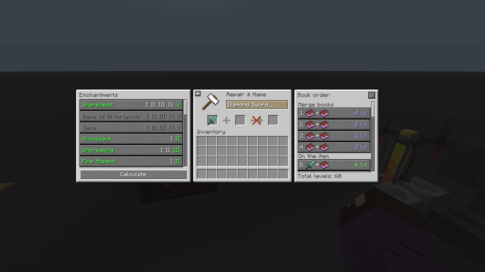
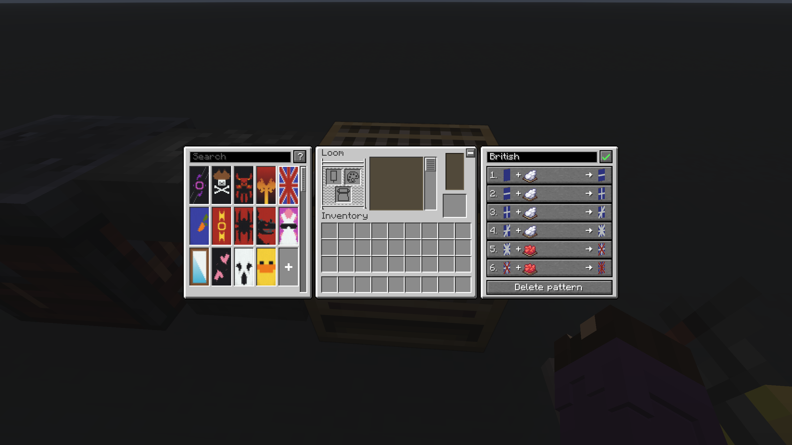
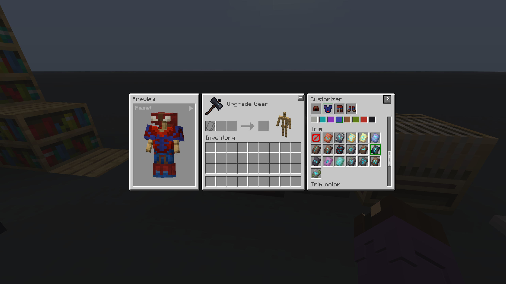
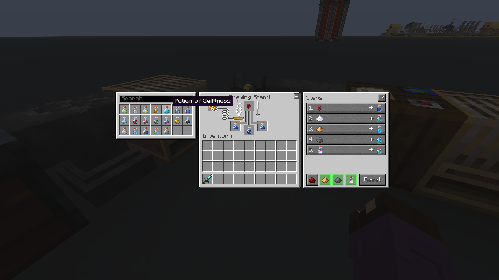
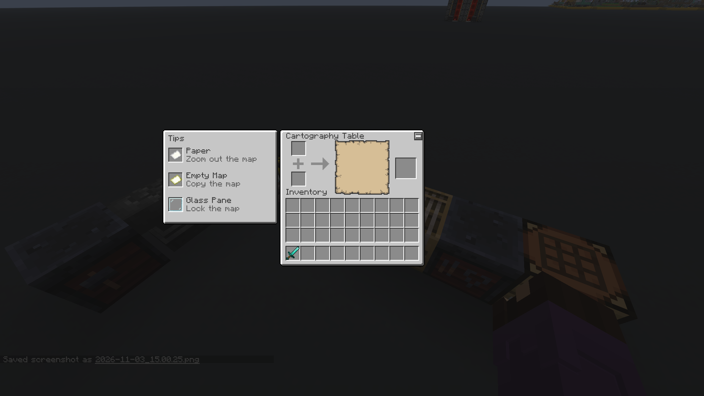
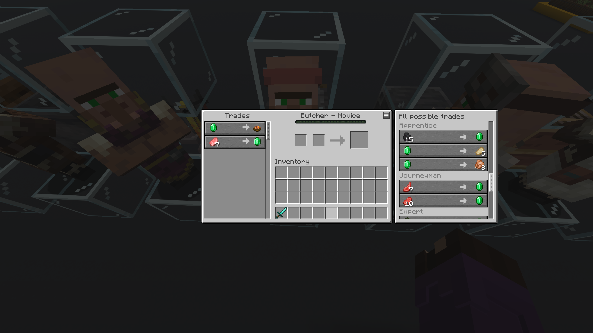

# Workstation Helper

Клиентский мод для Minecraft (Fabric): добавляет к рабочим столам панели-подсказки в стиле игры. Работает только у тебя в игре — на сервер ставить не нужно.

*Client-side Fabric mod that adds vanilla-style helper panels to Minecraft workstations. English and Russian are supported.*

## Что умеет

- **Наковальня** — планировщик зачарований: выбираешь зачарования, мод считает самый дешёвый порядок соединения книг и ведёт по шагам.
- **Кузнечный стол** — кастомизатор брони с предпросмотром (материал, цвет, отделка), подсказка, где найти шаблоны отделки.
- **Стол картографа** — небольшие подсказки.
- **Стол зачарования** — 3D-схема книжных полок вокруг стола: сколько работает и что мешает остальным.
- **Ткацкий станок** — готовые флаги и свои сохранённые узоры, пошаговое создание, подсказки по узорам и копированию флага.
- **Варочная стойка** — список зелий с поиском, шаги приготовления и небольшие подсказки.
- **Камнерез** — книга рецептов как у верстака.
- **Печь, коптильня, плавильная печь** — вкладка «Топливо»: сколько предметов переплавит каждое топливо.
- **Точило** — подсказка, что оно умеет.
- **Жители и странствующий торговец** — панель «Все возможные торги» по всем уровням профессии.

Каждую панель можно скрыть кнопкой «−/+» в углу окна. Весь мод выключается в настройках: «Специальные возможности» → «Помощник».

## Скриншоты

**Наковальня: планировщик зачарований.** Выбери нужные зачарования (несовместимые станут серыми), нажми «Рассчитать» — мод найдёт самый дешёвый порядок соединения книг, проведёт по шагам и покажет, сколько всего уровней уйдёт.



**Ткацкий станок: готовые флаги по шагам.** Выбери флаг слева (в том числе свои сохранённые узоры) — справа появятся все шаги по порядку: какой краситель и какой узор. Мод сам кладёт предметы в станок.



**Кузнечный стол: примерка брони.** Выбери часть брони, цвет красителя, узор отделки и её цвет — результат сразу виден на модели. Кнопка «?» показывает, где найти каждый шаблон отделки.



**Варочная стойка: любое зелье по шагам.** Выбери зелье в списке с поиском — увидишь все ингредиенты в правильном порядке. Внизу включаются добавки: дольше, сильнее, взрывное или туманное.



**Стол картографа: быстрые подсказки.** Что делает каждый предмет: бумага уменьшает масштаб карты, пустая карта копирует её, стеклянная панель блокирует.



**Жители: все возможные торги.** Все торги, которые житель может предложить, по уровням профессии — ещё до прокачки. Работает для всех профессий и странствующего торговца.



## Установка

1. Установи [Fabric Loader](https://fabricmc.net/use/) и [Fabric API](https://modrinth.com/mod/fabric-api).
2. Скачай jar под свою версию игры со страницы [Releases](../../releases).
3. Положи jar в папку `mods`.

| Minecraft | Файл мода | Fabric Loader | Fabric API |
|---|---|---|---|
| 26.3 | `workstation-helper-1.7.0+mc26.3.jar` | 0.19.5+ | 0.163.0+26.3 |
| 26.2 | `workstation-helper-1.7.0+mc26.2.jar` | 0.19.3+ | 0.158.0+26.2 |

Нужна Java 25.

## Сборка из исходников

```
gradlew build
```

Готовый мод появится в `build/libs`. Исходники в репозитории — для Minecraft 26.3.

## Лицензия

MIT — см. [LICENSE](LICENSE).
